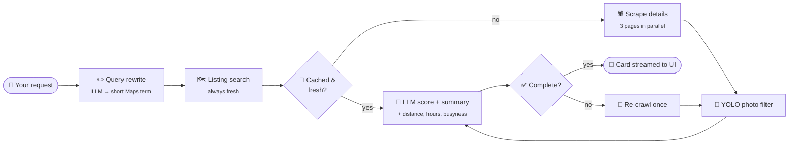

<div align="center">

# ☕ PlacesFinder

**A personal search engine for cafes & restaurants in Hanoi — ask for anything, get places that actually match.**

*"quán yên tĩnh có ổ cắm để làm việc" · "bánh socola đậm vị" · "còn mở, tránh giờ đông"*


-8A2BE2)


</div>

---

## ✨ What it does

Google Maps is great at *"cafe near me"* and terrible at *"cafe near me with a quiet upstairs and
good matcha"*. PlacesFinder bridges that gap:

| | |
|---|---|
| 🗺️ **No paid API** | Google Maps is scraped on demand with Playwright/Patchright |
| 🧠 **Reads the reviews for you** | An LLM scores every place 0–10 against your *exact* request, grounded in its real (recent-weighted) reviews, and writes a one-line summary |
| 📸 **Only good photos** | A YOLO classifier + blur filter keeps the blurry/irrelevant shots out of the card |
| ⚡ **Results stream in** | Cards appear one by one over SSE as each place finishes — no staring at a spinner for the whole batch |
| 🕒 **Knows when to go** | Opening hours + today's *Popular times* curve → "Đang mở · 7h–22h", "Đông nhất 15–17h · hiện giờ khá vắng" — and the LLM uses them too |
| 🌐 **Tiếng Việt / English** | A VI/EN toggle switches the whole UI *and* the LLM prompts, so summaries come back in the chosen language |
| 💾 **Cached per place** | Photos/reviews live in Postgres for `CACHE_TTL_DAYS`, reused across any search that finds that place |

> 🗂️ This project supersedes the original TikTok/Instagram coffee-shop-review pipeline, archived under
> [`legacy/`](legacy/) (old Selenium crawlers, YOLO training data). The `best_cls.pt` photo-quality
> classifier from that era is still used live — see `backend/infrastructure/vision/`.

---

## 🔍 How a search works



1. **✏️ Query rewrite** (`QueryRewriteService`) — your free-text request is simplified into a short
   term Maps' own search box can match (category/name only — Maps can't search for "must have dark
   chocolate cake").
2. **🗺️ Listing search** (`PlacesProvider.search_listings`) — always runs fresh, so results reflect the
   current query. Distances are known right away from listing coordinates.
3. **💾 Per-place cache** (`PlaceRepository.find_by_id`) — a place's photos/reviews/hours are reused if
   crawled within `CACHE_TTL_DAYS`; otherwise `fetch_details_stream` scrapes it (3 detail pages at a time).
4. **📸 Photo filtering** — photos are classified in small batches, stopping as soon as enough good ones
   are found.
5. **🧠 Ranking** (`RankingService` + `SummaryService`) — your *full, original* request is matched against
   the place's reviews, plus its distance, open-now status and current busyness (`place_context.py`).
   Final rank = `RANKING_WEIGHT_RELEVANCE` × relevance + `RANKING_WEIGHT_DISTANCE` × proximity.
6. **✅ Completeness check** — a card needs a summary and at least 4 photos. A freshly crawled place that
   comes back incomplete is re-crawled once in the same request; if it still fails, its cache entry is
   dropped so the next search tries again.
7. **⚡ Streaming** — `GET /api/search/stream` emits one SSE `place` event per finished card, then `done`.
   The browser re-sorts cards by score as they arrive.

---

## 🏛️ Architecture

Clean Architecture, mirroring the layer split of the sibling SlideGen project:

```
backend/
├── 🌐 api/              FastAPI routes, Jinja2 templates (HTMX + SSE), static assets
├── ⚙️ application/      Services orchestrating use cases (search, ranking, summary, query rewrite,
│                        hours/busyness context)
├── 💎 domain/           Entities + Ports (interfaces) — pure Python, no third-party deps
└── 🔌 infrastructure/   Concrete adapters:
                         • places/     Patchright Google Maps scraper
                         • database/   Postgres (SQLAlchemy async) repository
                         • vision/     YOLO photo classifier
                         • llm/        OpenAI-compatible chat client (self-hosted Qwen via vLLM)
                         • geocoding/  Photon (OpenStreetMap) address → coordinates
```

🔄 Swapping the data source later (e.g. to the official Google Places API) means adding one new
`infrastructure/places/` implementation of the `PlacesProvider` port — nothing in `application/`,
`domain/` or `api/` has to change.

---

## 📦 Requirements

- 🐍 [uv](https://docs.astral.sh/uv/) for the Python env/deps
- 🐳 Docker Desktop, to run the app + Postgres locally
- 🔑 A Google account signed in once via `scripts/google_login_setup.py` (see below) — without it,
  Maps serves a stripped "limited view" with no reviews to automated sessions
- 🤖 An OpenAI-compatible `/chat/completions` endpoint for the LLM (default: a self-hosted
  Qwen3.5-35B on vLLM) — without one, results still work but fall back to distance-only ranking
  with no summaries

---

## 🚀 Getting started

### 1️⃣ One-time setup: Google login

```bash
uv sync
uv run python scripts/google_login_setup.py
```

Opens a real (headed) browser for an interactive login and saves the session to
`.secrets/google_auth_state.json` (gitignored).

> [!IMPORTANT]
> The account's **language must be set to English** in its Google Account settings — the scraper
> matches Maps UI elements by English text, and Maps follows the account language once signed in,
> not the browser locale. Re-run the script whenever Google invalidates the session.

### 2️⃣ Run with Docker

```bash
cp .env.example .env        # point LLM_API_URL / LLM_API_KEY at your endpoint
docker compose up --build   # app image (Chromium for Patchright + Xvfb) + Postgres/pgvector
uv run alembic upgrade head # first run, and after pulling new migrations
```

Then open **http://localhost:8000**, allow location access (or type an address / Plus Code /
coordinates — handy on mobile, where browsers block geolocation on non-HTTPS origins) and search. 🎉

### 🛠️ Running the API without Docker (Postgres still via Docker)

```bash
docker compose up -d db     # Postgres only
uv sync
uv run alembic upgrade head
uv run uvicorn backend.api.app:app --host 0.0.0.0 --port 8000
```

> [!NOTE]
> The scraper runs Chromium **headed** (Maps' review tab bar doesn't render headless). On
> Windows/macOS that just opens a visible browser window; the Docker image runs it under Xvfb.

---

## ⚙️ Key configuration

| Variable | Default | What it does |
|---|---|---|
| `CACHE_TTL_DAYS` | `14` | How long a crawled place is reused before re-scraping |
| `DEFAULT_SEARCH_RADIUS_M` | `3000` | Search radius around you |
| `MAX_CRAWL_RESULTS` / `MAX_DETAIL_PAGES` | `12` | Places per search — **keep these equal** |
| `LLM_ENABLED` | `true` | Turn LLM ranking/summaries on/off |
| `LLM_API_URL` / `LLM_MODEL_NAME` | Qwen vLLM proxy | OpenAI-compatible chat endpoint + model |
| `LLM_REASONING_ENABLED` | `false` | Sends the top-level `thinking` flag |
| `RANKING_WEIGHT_RELEVANCE` / `RANKING_WEIGHT_DISTANCE` | `0.6` / `0.4` | Blend of match score vs. proximity |

See [`.env.example`](.env.example) for the full list.

---

## 🗺️ Roadmap

- [x] On-demand Google Maps scraping (listings + reviews + review photos), per-place Postgres cache
- [x] YOLO + blur photo-quality filtering
- [x] LLM ranking: query-aware relevance score + grounded summary, blended with distance
- [x] Streaming results (SSE), parallel detail scraping, automatic re-crawl of incomplete places
- [x] Opening hours + popular times, shown on cards and fed to the LLM
- [x] Manual address / Plus Code / coordinate entry (Photon geocoding)
- [x] Vietnamese / English UI + LLM output
- [ ] Swap the scraper for the official Google Places API once this goes beyond personal use

<div align="center">

---

Made with ☕ in Hà Nội

</div>
